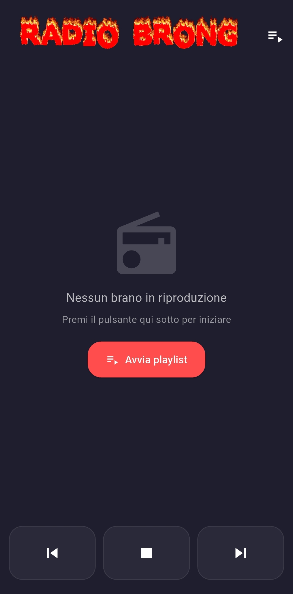
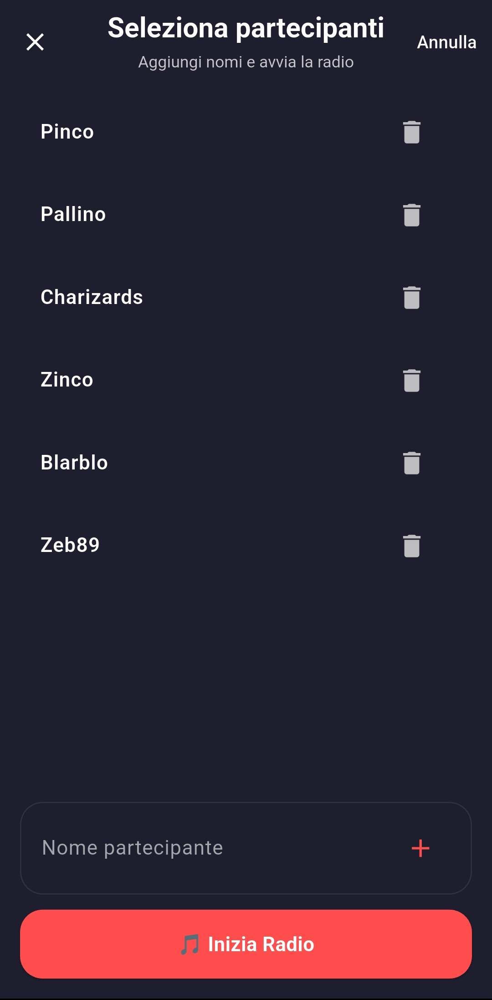
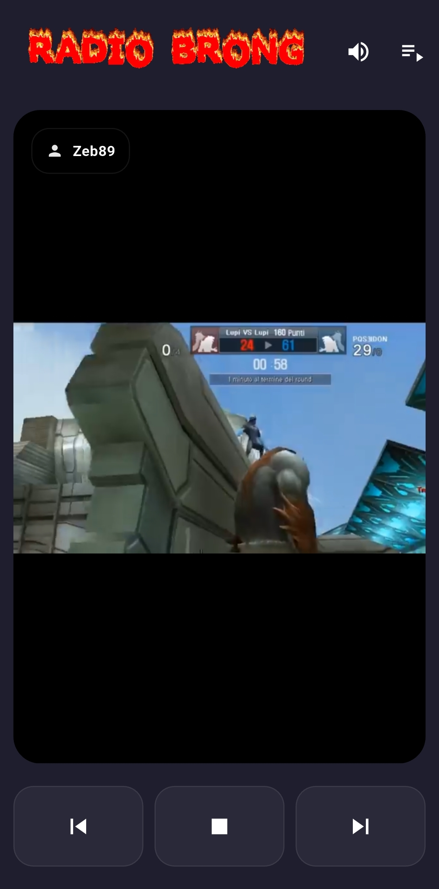

Benvenuti su **Radio Brong!**

Questa è un'app per mobile, dove i partecipanti selezionano una canzone ciascuno, e viene creata una playlist dalle canzoni selezionate.

## Feature principali

- Randomizza l'ordine dei partecipanti, e quindi delle canzoni
- Pesca randomicamente una delle tante intro / jingle che ho creato per sopperire al fatto che ho completamente vibe codato tutto il progetto e la riproduce 
- Salva l'ultimo punto di ascolto per riprendere la riproduzione da dove si è interrotta
- Temi festivi!
- Volume booster
- Media controls funzionanti (a malapena)
- Tanto divertimento con amici e nemici

## Screenshot

<table>
  <tr>
    <td></td>
    <td></td>
    <td></td>
  </tr>
</table>

